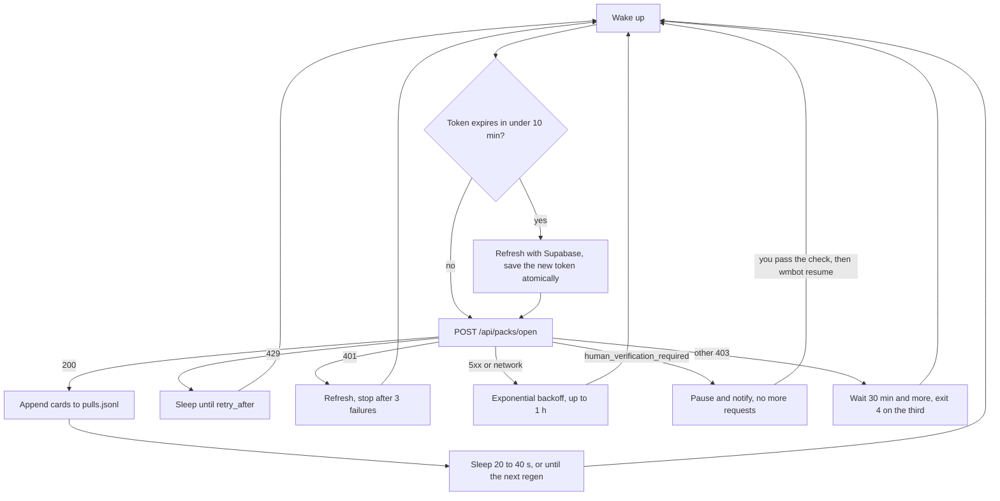

<p align="center">
  
</p>

<h1 align="center">wmbot</h1>

<p align="center">
  Opens your <a href="https://www.wiki-masters.com">WikiMasters</a> packs as they regenerate, logs every card and writes a daily report.
</p>

<p align="center">
  
  
  
  
</p>

> [!WARNING]
> **Use at your own risk.** The [site's terms](https://www.wiki-masters.com/terms) (section 6) list "utilisation d'automatisation" as grounds for warning, suspending or permanently deleting an account, and for cancelling rewards, with no notice and no refund. Running this bot breaks those terms. The site also runs anti-bot checks, and the author's own run hit one after a few packs. If you care about your account, don't run this.

WikiMasters is a French card game where the cards are Wikipedia pages. wmbot is an unofficial personal project, not affiliated with the site. It handles one account, and it respects rate limits. When the site asks for a human, it pauses until you have passed the check yourself: there is no captcha or verification bypass here and there won't be one.

**Project status:** the code is tested against a local mock server only. This version has not run against the live site. Response formats come from observing the earlier script, so they can change without warning.

## How it works



Packs regenerate every 10 minutes, the stock caps at 10, and each pack has 5 cards. The login page has a captcha, so wmbot never logs in with a password. It uses a refresh token you copy from your own browser session. Those tokens rotate on each use, which is why wmbot saves every new one before doing anything else and holds a lock so that only one process uses a session.

## 5-minute setup

You need Python 3.10+ on Linux or macOS. Windows isn't supported, use Docker there.

**1. Install**

```bash
git clone https://github.com/AirKyzzZ/wikimasters-bot
cd wikimasters-bot
python3 -m venv .venv
.venv/bin/pip install .
```

**2. Copy your refresh token**

1. Open a **private window**, log in on wiki-masters.com and open the developer console (F12).
2. Read this snippet, then paste it. It only copies the token to your clipboard:

   ```js
   (() => {
     const parts = document.cookie.split("; ")
       .filter((c) => c.startsWith("sb-cyrxjeppjqsxxjayfrur-auth-token"))
       .sort((a, b) => (+a.match(/\.(\d+)=/)?.[1] || 0) - (+b.match(/\.(\d+)=/)?.[1] || 0))
       .map((c) => c.slice(c.indexOf("=") + 1));
     if (!parts.length) return console.log("No readable cookie, use the Application tab instead.");
     const raw = parts.join("");
     const json = raw.startsWith("base64-")
       ? atob(raw.slice(7).replace(/-/g, "+").replace(/_/g, "/"))
       : decodeURIComponent(raw);
     copy(JSON.parse(json).refresh_token);
     console.log("Refresh token copied to the clipboard.");
   })();
   ```

3. **Close the private window without logging out.** Logging out revokes the token, and a browser left open will try to use it too.

The token is a password equivalent: don't paste it into chats, issues or shell commands.

**3. Store it**

```bash
.venv/bin/wmbot login
```

The input is hidden. wmbot exchanges the token right away and saves the session with mode 600 in `~/.secrets/wikimasters.session.json`.

**4. Run it**

```bash
.venv/bin/wmbot run
```

In another terminal, `.venv/bin/wmbot status` shows what it's doing.

## Commands

| Command | What it does |
| --- | --- |
| `wmbot run` | Runs until stopped |
| `wmbot login [--force]` | Stores a new refresh token |
| `wmbot status [--json]` | Shows state, offline, with no network call and no token output |
| `wmbot report [--date YYYY-MM-DD] [--stdout] [--discord]` | Writes `reports/YYYY-MM-DD.md` in the data directory |
| `wmbot resume [--yes]` | Continues after you passed the human verification yourself |

While running, the bot writes yesterday's report once a day. New versus duplicate is computed from your local `pulls.jsonl`, so cards you owned before installing wmbot count as new the first time.

## Configuration

Everything is optional and comes from the environment or a `.env` file, see [`.env.example`](.env.example). Real environment variables win over the file.

| Variable | Default | Purpose |
| --- | --- | --- |
| `WM_SESSION_FILE` | `~/.secrets/wikimasters.session.json` | Rotating session |
| `WM_DATA_DIR` | `~/.local/share/wmbot` | `pulls.jsonl`, `state.json`, `reports/` |
| `WM_DISCORD_WEBHOOK` | none | Daily report and stop alerts |
| `WM_ANON_KEY` | found on the site | Public Supabase key |
| `WM_AUTO_REPORT` | `1` | Daily report while running |
| `WM_ON_VERIFICATION` | `pause` | `pause` keeps the process idle, `exit` stops it with code 5 |
| `TZ` | system | Where report days start and end |

## Running as a service

**systemd (user unit)**

```bash
pipx install .    # or adjust ExecStart to your venv
mkdir -p ~/.config/systemd/user ~/.config/wmbot
cp deploy/wmbot.service ~/.config/systemd/user/
cp .env.example ~/.config/wmbot/env
systemctl --user daemon-reload
systemctl --user enable --now wmbot
loginctl enable-linger "$USER"
journalctl --user -u wmbot -f
```

**Docker**

```bash
docker build -t wmbot .
docker run --rm -it -v wmbot-data:/data wmbot login
docker run -d --name wmbot --restart on-failure:5 -v wmbot-data:/data wmbot
docker exec wmbot wmbot status
```

## Exit codes

systemd doesn't restart the bot on codes 2 to 5, because restarting wouldn't help.

| Code | Meaning | What to do |
| --- | --- | --- |
| 0 | Stopped by a signal | Nothing |
| 1 | Config, session file or unexpected error | Read the log |
| 2 | The session is dead | Get a new token, `wmbot login --force` |
| 3 | Another process holds the lock | Stop the other one |
| 4 | The site keeps answering 403 | Check your account in a browser |
| 5 | Human verification with `WM_ON_VERIFICATION=exit`, or the pause marker could not be written | See below |

## Troubleshooting

**`the site asks for human verification`.** The site's anti-bot check fired, and the bot switches to human-in-the-loop mode:

1. It stops calling the site and Supabase, leaves your session alone, writes `halted.json` and sends one Discord alert if `WM_DISCORD_WEBHOOK` is set. Restarts and reboots stay paused.
2. Log in on the site yourself in a browser and pass the check. Use a private window and close it without logging out, as in setup step 2.
3. Run `wmbot resume` and confirm. The running bot continues within seconds (in Docker: `docker exec -it wmbot wmbot resume`).

If the check is still pending, the next request pauses it again, so one resume costs one request. Think about whether to keep going at all: this is a clear signal that the site has noticed the automation.

**`refresh rejected (400 refresh_token_already_used)`.** The token was used somewhere else, usually a browser left open or a second bot. Supabase can revoke the whole session when an old token is reused. Redo step 2 and run `wmbot login --force`.

**`No readable cookie` from the snippet.** The cookie may be HttpOnly. Open DevTools, Application (Storage in Firefox), Cookies, and join the values of `sb-...-auth-token.0`, `.1` and so on. Drop the `base64-` prefix, decode it as base64url and read `refresh_token`.

**`could not find the public anon key`.** The site changed its bundles. Set `WM_ANON_KEY`, which is the public key visible in the requests your browser sends to `supabase.co`.

**`another wmbot process holds ...`.** Only one process may use a session. Look for it with `pgrep -af wmbot`.

**Nothing opens and there's no error.** `wmbot status` shows the next attempt. A daily limit can make the bot sleep for many hours.

## FAQ

**Can it get past the captcha or the verification check?** No, and pull requests adding that will be closed.

**Can I run several accounts?** No. It's against the terms, and wmbot isn't built for it.

**Why does it open packs so slowly?** It waits 20 to 40 seconds between packs and sleeps through regeneration. It's meant to stay polite, not to be undetectable.

**Does it trade, sell or battle?** No. It only opens packs.

**Where do my tokens go?** To `www.wiki-masters.com` (session cookie) and your project's `supabase.co` endpoint. HTTPS is enforced, redirects are not followed, and logs redact tokens.

**Why no dependencies?** The standard library is enough here, and there's less to audit in code that holds your session.

## Development

```bash
PYTHONPATH=src python3 -m unittest discover -s tests -t .
```

Tests run a real local HTTP server and never reach the site. The code is a small package rather than one file so token handling (`session.py`) stays isolated and testable:

| Module | Role |
| --- | --- |
| `session.py` | Token storage, rotation, lock, cookie format |
| `client.py` | Calls the pack endpoint and classifies the answer |
| `runner.py` | Wait, backoff and stop decisions |
| `pulls.py`, `report.py` | Log, markdown report, Discord |
| `net.py`, `config.py`, `cli.py` | HTTP without redirects, redaction, env, commands |

## En français

**wmbot** ouvre tes paquets WikiMasters dès qu'ils se régénèrent, garde la liste des cartes et écrit un rapport quotidien.

**À tes risques et périls :** les [conditions du site](https://www.wiki-masters.com/terms) (section 6) citent l'« utilisation d'automatisation » comme motif de suspension ou de suppression définitive du compte, sans préavis. Le site a aussi des contrôles anti-bot. Si tu tiens à ton compte, ne l'utilise pas.

Le bot gère un seul compte et respecte les limites du site. Si le site demande une vérification humaine, il se met en pause et te prévient. Passe le contrôle toi-même dans ton navigateur, puis lance `wmbot resume`. Il ne contourne aucun captcha ni aucune vérification.

Installation : suis le « 5-minute setup » ci-dessus. Récupère le jeton dans une fenêtre privée, puis ferme-la **sans te déconnecter**.

## Licence

[MIT](LICENSE)
